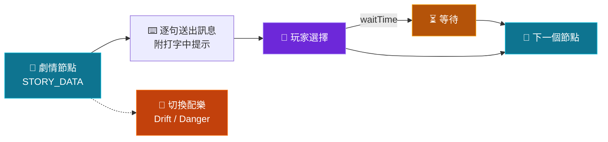
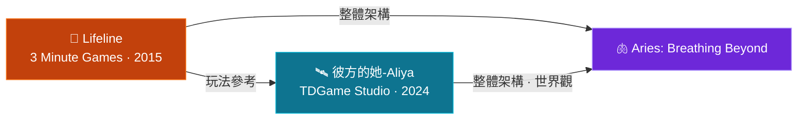

<div align="center">


**彼端的呼吸 · Aries**

<br>


<br><br>

[關於](#about) · [特色](#features) · [玩法](#play) · [運作方式](#how) · [靈感來源](#inspirations) · [專案結構](#structure) · [版權與聲明](#copyright)

</div>

<br>

```text
╔══════════════════════════════════════════╗
║  COSMOS TERMINAL  //  LINK ESTABLISHED   ║
╠══════════════════════════════════════════╣
║  PROJECT    Aries: Breathing Beyond      ║
║  TYPE       Browser story game (HTML)    ║
║  INSPIRED   Aliya: Timelink / Lifeline   ║
║  WORLD      Same setting as Aliya        ║
║  PLAY       Open the .html in a browser  ║
╚══════════════════════════════════════════╝
```

<a id="about"></a>

## `01` 關於 · About

**Aries: Breathing Beyond**（彼端的呼吸）是一款以 HTML 編寫的瀏覽器聊天式科幻敘事遊戲。

一道跨越千年的訊號，把你和一名在飛船事故中倖存的研究員艾瑞斯（Aries）連在了一起。你透過選擇與他對話，陪他度過一次又一次的危機。

遊戲的玩法與整體架構參考了《彼方的她-Aliya》（Aliya: Timelink）與《生命線》（Lifeline），世界觀背景與《彼方的她-Aliya》一致。

```text
[ARIES]  喂？COSMOS
[ARIES]  我是船員艾瑞斯，我們現在位於距離地球1000光年的系外軌道，
         飛船似乎受到隕石撞擊！
[ARIES]  故障代碼3
[YOU  ]  你是誰？為什麼會連到我的電腦？還在我的瀏覽器裏彈出這個？
```

<sub>↑ 開場片段</sub>

---

<a id="features"></a>

## `02` 特色 · Features

| 💬 聊天式敘事 | ⏳ 現實時間等待 | 🎵 動態配樂 |
| :--- | :--- | :--- |
| 對方的訊息逐句送達，附打字中提示動畫與提示音，你的回覆以按鈕選項呈現。 | 部分選擇之後，對方會「失聯」一段時間再回覆，從數秒到最長一小時不等。 | 平時播放 Drift，進入危險場景時切換為 danger，另有選項點擊音效與播放 / 暫停控制。 |

| 💓 生命體徵面板 | 💾 進度保存 | 🖥️ 單檔 HTML |
| :--- | :--- | :--- |
| 即時心率數字與心電圖動畫，危險場景心率升高；O2 / H2O / ENG 狀態條隨劇情輕微變化。 | 點擊 SAVE 把進度存在瀏覽器本地，開始畫面可「加載進度」或「重置遊戲」。 | 不用安裝，用瀏覽器打開就能玩。 |

### 🖼️ 介面一覽

```text
┌──────────────────────────────────────────────────────────────┐
│ Operation  SOS  FCS  Settings        Play  Pause  SAVE       │
├─────────────────────────────────┬────────────────────────────┤
│ CHAT                            │ ARIES (B-704)              │
│                                 │ HEART RATE   ~~ECG~~       │
│ [ incoming message ]            │ O2 | H2O | ENG  (bars)     │
│                                 │ HRM  EOG  EH  (toggles)    │
│          [ your reply ]         │ COSMOS CONTROL SYSTEM      │
│                                 │────────────────────────────│
│ [ typing ... ]                  │ CHOICES                    │
│                                 │ [ choice A ]               │
│                                 │ [ choice B ]               │
└─────────────────────────────────┴────────────────────────────┘
```

<!--
  在這裡加入遊戲截圖：
  
-->

---

<a id="play"></a>

## `03` 玩法 · How to Play

| 步驟 | 操作 |
| :---: | :--- |
| **1** | 在瀏覽器（建議 Chrome / Edge）中打開 `Aries： Breathing beyond.html` |
| **2** | 點擊「**初始化系統**」進入遊戲；之前玩過的話，可以點「**加載進度**」繼續 |
| **3** | 閱讀對方的訊息，從右下角的選項中選擇你的回覆 |
| **4** | 想中途離開時，點擊右上角的 **SAVE** 保存進度 |

> [!NOTE]
> 遊戲的樣式、字體與圖示來自網路上的 CDN，所以第一次打開時需要連上網路。背景音樂需要在點擊「初始化系統」之後才會開始播放。

---

<a id="how"></a>

## `04` 運作方式 · How It Works



整個劇情保存在 `STORY_DATA` 裡，每個節點由對話 `lines` 和選項 `choices` 組成，每個選項指向下一個節點 `next`，並可以用 `waitTime`（秒）讓對方「失聯」一段時間。要新增劇情，只需要增加節點：

```js
node_id: {
  lines: ["..."],
  choices: [
    { text: "...", next: "other_node", waitTime: 10 }
  ]
}
```

### 🧰 技術棧

| 項目 | 用途 |
| :--- | :--- |
| **HTML5 + Vanilla JavaScript** | 遊戲本體與劇情邏輯 |
| **Tailwind CSS**（CDN） | 介面樣式 |
| **Font Awesome 6.4**、**Google Fonts**（Inter、Share Tech Mono） | 圖示與字體 |
| **Web Audio API** | 對方訊息的提示音 |
| **HTML Audio** | 背景音樂與選項點擊音效 |
| **localStorage** | 進度保存 |

---

<a id="inspirations"></a>

## `05` 靈感來源 · Inspirations

| 🛰️ 《彼方的她-Aliya》<br><sub>Aliya: Timelink</sub> | 📱 《生命線》<br><sub>Lifeline</sub> |
| :--- | :--- |
| **開發**　TDGame Studio（瞳電遊工作室）<br>**發行**　Another Indie<br>**首發**　2024 年 4 月（Steam） | **開發**　3 Minute Games<br>**編劇**　Dave Justus<br>**首發**　2015 年 |
| 文字冒險遊戲。玩家意外連上千年之後、在太空中遇險的少女，透過與現實時間同步的對話，一同化解危機、探尋真相。 | 以簡訊對話推進的選擇式文字冒險。玩家是墜落在遙遠星球的太空人 Taylor 唯一能聯絡的人，故事以現實時間進行，並以通知提醒玩家。 |
| [🔗 在 Steam 查看](https://store.steampowered.com/app/2704110/Aliya/) | [🔗 3 Minute Games 官網](https://www.3minute.games) |



---

<a id="structure"></a>

## `06` 專案結構 · Structure

```text
Aries-Breathing-Beyond/
├── Aries：Breathing beyond/
│   ├── audio/                       # Drift / danger / sound-choice
│   ├── Aries： Breathing beyond.html   # 遊戲本體
│   └── Audio test.html              # 音頻測試頁
├── Copyright Notice.md              # 版權聲明
└── README.md
```

---

<a id="copyright"></a>

## `07` 版權與聲明 · Copyright & Disclaimer

> [!IMPORTANT]
> 本專案是依照《彼方的她-Aliya》與《生命線》的玩法所編寫的同人／致敬作品，並非兩款遊戲的官方內容，也與 TDGame Studio（瞳電遊工作室）、Another Indie 及 3 Minute Games 並無官方關聯。原作的角色、世界觀設定等相關權利均屬其各自的權利人。詳細說明請見 [Copyright Notice](./Copyright%20Notice.md)。

如果你喜歡這類遊戲，也請支持正版原作 💙

* 🛰️ [Aliya: Timelink（Steam）](https://store.steampowered.com/app/2704110/Aliya/)
* 📱 [Lifeline（3 Minute Games）](https://www.3minute.games)

---

<div align="center">

**Created by [AriesLinux](https://github.com/AriesLinux)**

<sub>`> transmission end_`</sub>


</div>
